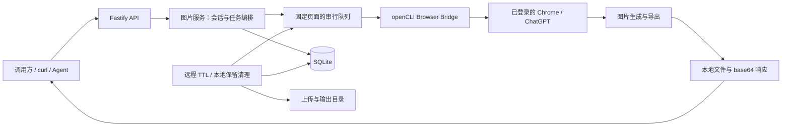

# image2api

将本机已登录的 ChatGPT 网页图片生成能力，封装成 OpenAI Images API 风格的本地 HTTP 服务。

适合通过 curl、脚本或 AI Agent 生图，并在同一个上下文中连续改图的个人开发者。当前版本为 **0.1.0（MVP）**，使用 **TypeScript + Fastify + SQLite + openCLI Browser Bridge**。

本服务通过真实 Chrome 页面操作 ChatGPT，并非 OpenAI 官方 API。`gpt-image-2` 是兼容别名，实际模型由 ChatGPT 网页决定；`size`、`quality` 和 `background` 通过提示词表达偏好，不能保证最终图片严格符合指定像素或质量参数。

## 功能

- 文生图，单张或多张参考图编辑。
- `session_id` 续聊，保持原 ChatGPT 对话上下文。
- `new_chat=true` 创建新图片对话。
- Bearer API Key、会话查询和手动删除。
- 生成、就绪检查、扫描、删除复用固定后台页面，统一串行执行。
- 远程会话默认闲置 2 小时过期；本地图片、上传文件和任务记录独立保留 7 天。
- 每日清理过期本地内容，启动时补清理，失败上传即时清理。

当前仅支持 `n=1` 和 `response_format=b64_json`。暂不支持 URL 响应、mask 局部编辑、流式图片和多账号并发。

## 工作原理



一次请求的处理过程：

1. 校验密钥、提示词和参数，创建任务记录。
2. 将网页操作加入队列，复用固定后台页面。
3. 新请求从指定 Project 创建对话；续聊请求打开原 conversation。
4. 上传参考图（如有），输入提示词，等待图片生成。
5. 导出文件到 `tmp/outputs`，保存任务和图片记录。
6. 返回 `data[].b64_json` 与 `session`，调用方解码保存图片。

会话绑定为 `API session_id ↔ ChatGPT conversation_id`。Project 用于整理，不承担隔离或权限控制。不同 API 会话通过同一个页面导航到各自的 conversation，不需要每个会话保留一个 Chrome 标签页。

## 运行条件

- macOS：当前管理脚本和实际运行验证基于 macOS。
- Node.js **20.18.1+**、npm、Python 3；脚本还使用系统 `curl`、`lsof`。
- Chrome 正在运行，ChatGPT 已登录且可使用图片生成。
- [openCLI Browser Bridge 扩展](https://chromewebstore.google.com/detail/opencli/ildkmabpimmkaediidaifkhjpohdnifk)已安装并连接。
- 本项目使用 openCLI **1.8.8**，详见 [openCLI 项目](https://github.com/jackwener/OpenCLI)。

## 安装与启动

克隆仓库、安装依赖，并创建本地配置：

```bash
git clone https://github.com/samni728/image2api.git
cd image2api
npm ci
cp .env.example .env
```

生成随机 API Key 并写入 `.env`，无需打印密钥：

```bash
python3 - <<'PY'
from pathlib import Path
import secrets

p = Path('.env')
lines = p.read_text().splitlines()
value = 'API_KEY=' + secrets.token_hex(32)
lines = [value if line.startswith('API_KEY=') else line for line in lines]
if not any(line.startswith('API_KEY=') for line in lines):
    lines.append(value)
p.write_text('\n'.join(lines) + '\n')
PY
```

建议创建专用 ChatGPT Project，例如 `Web to API 的 image`，从 Project 页面地址获取并填写：

```dotenv
CHATGPT_PROJECT_NAME=Web to API 的 image
CHATGPT_PROJECT_ID=<项目 ID，不含 g-p- 前缀>
CHATGPT_PROJECT_URL=https://chatgpt.com/g/g-p-<项目 ID>/project
```

请使用本服务专用的 Project：没有本地 session 对应的对话也会进入孤儿会话清理，不要在其中保存需要长期保留的个人聊天。未配置 Project 时，从普通新对话生图，并跳过 Project 孤儿扫描。

检查 Browser Bridge 并启动：

```bash
npx opencli doctor
chmod +x manage.sh
./manage.sh start
./manage.sh status
./manage.sh health
```

程序和 `.env.example` 默认端口为 **3811**，当前开发机实际为 **3812**。管理脚本发现端口占用时，会在 `3811–3899` 选择空闲端口并写回 `.env`。实际地址始终以 `.env` 和 `./manage.sh status` 为准。

## curl 调用

在项目根目录读取实际端口和密钥；以下示例适用于默认的本机监听地址：

```bash
IMAGE_API_PORT=$(sed -n 's/^PORT=//p' .env)
IMAGE_API_KEY=$(sed -n 's/^API_KEY=//p' .env)
IMAGE_API_BASE="http://127.0.0.1:${IMAGE_API_PORT:-3811}"
```

这里采用不带引号的 `.env` `KEY=value` 写法；服务自身由 dotenv 读取配置。若修改 `HOST`，请调整 Base URL；重启后若端口变化，请重新读取变量。

### 文生图

```bash
curl -sS --max-time 360 \
  "$IMAGE_API_BASE/v1/images/generations" \
  -H "Authorization: Bearer $IMAGE_API_KEY" \
  -H 'Content-Type: application/json' \
  -d '{
    "model": "gpt-image-2",
    "prompt": "一只银渐层小猫坐在窗边，柔和阳光，写实摄影，无文字",
    "size": "1024x1024",
    "quality": "medium",
    "n": 1,
    "response_format": "b64_json"
  }' \
  -o /tmp/image2api-result.json
```

响应结构如下，时间字段为 Unix 秒：

```json
{
  "created": 0,
  "data": [{ "b64_json": "<图片 base64>", "revised_prompt": null }],
  "session": {
    "session_id": "imgsess_xxx",
    "conversation_id": "<远程 conversation ID>",
    "conversation_url": "https://chatgpt.com/.../c/...",
    "expires_at": 0,
    "ttl_seconds": 7200
  }
}
```

解码保存，文件后缀按实际图片类型选择：

```bash
python3 - <<'PY'
from pathlib import Path
import base64, json

result = json.loads(Path('/tmp/image2api-result.json').read_text())
if 'error' in result:
    raise SystemExit(result['error'])
raw = base64.b64decode(result['data'][0]['b64_json'])
ext = ('png' if raw.startswith(b'\x89PNG\r\n\x1a\n') else
       'jpg' if raw.startswith(b'\xff\xd8\xff') else
       'webp' if raw[:4] == b'RIFF' and raw[8:12] == b'WEBP' else
       'gif' if raw.startswith((b'GIF87a', b'GIF89a')) else 'bin')
output = Path('/tmp/image2api-generated.' + ext)
output.write_bytes(raw)
print('图片：', output)
print('session_id：', result['session']['session_id'])
PY
```

### 参考图编辑

将图片路径替换为自己的文件；多图可重复添加 `image` 或 `image[]`，最多 8 张，默认每张上限 20 MiB。

```bash
curl -sS --max-time 360 \
  "$IMAGE_API_BASE/v1/images/edits" \
  -H "Authorization: Bearer $IMAGE_API_KEY" \
  -F 'prompt=保持主体不变，把背景改成深蓝色夜景' \
  -F 'response_format=b64_json' \
  -F 'image=@/absolute/path/reference.png' \
  -o /tmp/image2api-result.json
```

### 继续改图

保存第一次返回的 `session_id`，随后带回即可沿用上下文，不必重复上传原图：

```bash
IMAGE_SESSION_ID=$(python3 -c "import json; print(json.load(open('/tmp/image2api-result.json'))['session']['session_id'])")

python3 - "$IMAGE_SESSION_ID" <<'PY'
from pathlib import Path
import json, sys
Path('/tmp/image2api-request.json').write_text(json.dumps({
    'prompt': '保持主体和构图不变，只把背景换成夜景',
    'session_id': sys.argv[1],
    'response_format': 'b64_json'
}, ensure_ascii=False))
PY

curl -sS --max-time 360 \
  "$IMAGE_API_BASE/v1/images/generations" \
  -H "Authorization: Bearer $IMAGE_API_KEY" \
  -H 'Content-Type: application/json' \
  --data-binary @/tmp/image2api-request.json \
  -o /tmp/image2api-result.json
```

`new_chat=true` 会创建新对话，旧会话仍按自己的 TTL 清理。`session_ttl_seconds` 可覆盖 TTL，最短 60 秒，默认上限 7200 秒。

### 查询与结束会话

```bash
# 查询
curl -sS "$IMAGE_API_BASE/v1/images/sessions/$IMAGE_SESSION_ID" \
  -H "Authorization: Bearer $IMAGE_API_KEY"

# 结束：删除远程聊天，立即清除关联本地文件和记录
curl -sS -X DELETE "$IMAGE_API_BASE/v1/images/sessions/$IMAGE_SESSION_ID" \
  -H "Authorization: Bearer $IMAGE_API_KEY"
```

## 浏览器复用

默认使用固定的 `adapter + persistent` 后台页面；生成、就绪检查、扫描和删除共用串行队列。维护操作不再每次启动子进程或创建随机浏览器 session，服务也不接管用户正在浏览的标签页。

页面默认空闲 **30 分钟**后允许 openCLI 回收，下一次调用再创建或恢复。服务正常停止时等待请求和清理完成，再释放自己的页面租约。

后台模式依赖真实 Chrome，不是无头浏览器。macOS 首次创建或回收后重建窗口仍可能抢焦点，见 [openCLI 上游问题 #2167](https://github.com/jackwener/OpenCLI/issues/2167)。复用减少重复创建开销，不能保证完全无弹窗或不占内存。

## 会话与文件清理

| 对象 | 默认保留规则 | 清理时机 |
| --- | --- | --- |
| 远程 ChatGPT 会话 | 最后一次成功活动后 2 小时过期 | 每小时扫描；启动时不立即访问网页 |
| Project 孤儿会话 | 首次发现后等待默认 TTL | 后续远程清理周期重试 |
| 本地图片、成功上传、job / asset 记录 | 保留最近 7 天 | 启动补清理，之后每 24 小时清理 |
| 失败上传 | 请求失败后移除 | 请求结束即时清理 |
| 未登记的遗留临时文件 | 按修改时间计算 7 天 | 每日本地清理兜底 |
| 调用方另存的副本 | 调用方自行管理 | 本服务不清理 |

每日清理意味着过期内容通常在约 **7～8 天**时移除；服务未运行时不执行定时任务，重启后补清理。

远程 TTL 自动删除成功后，本地图片和历史保留到本地保留期结束。手动 `DELETE session` 立即清理关联的本地文件和记录。远程删除失败会保留 session / orphan 映射用于重试，不能保证这些重试映射在 7 天内消失。

本地清理只处理配置上传、输出目录中服务创建的文件，不递归删除其他目录，不跟随符号链接。正在使用的资源会跳过；文件删除失败保留记录等待重试。

`logs/service.log` 不属于图片及 job / asset 的 7 天清理范围，可按需要另行归档。

## 配置

完整示例见 `.env.example`，主要参数如下：

| 配置 | 默认值 | 作用 |
| --- | --- | --- |
| `HOST` | `127.0.0.1` | 监听地址 |
| `PORT` | `3811` | 默认端口，开发机当前为 3812 |
| `API_KEY` | 示例为 `change-me` | Bearer 密钥，使用前生成随机值 |
| `OPENCLI_BROWSER_SESSION` | `web2api-image-worker-1` | 固定浏览器会话名称 |
| `OPENCLI_WINDOW_MODE` | `background` | 可改为 `foreground` 调试 |
| `OPENCLI_BROWSER_IDLE_SECONDS` | `1800` | 页面空闲回收时间，单位秒 |
| `SESSION_DEFAULT_TTL_SECONDS` | `7200` | 默认远程会话 TTL |
| `SESSION_MAX_TTL_SECONDS` | `7200` | 请求 TTL 上限 |
| `SESSION_CLEANUP_INTERVAL_SECONDS` | `3600` | 远程清理间隔 |
| `LOCAL_RETENTION_DAYS` | `7` | 本地文件、任务历史保留天数 |
| `LOCAL_CLEANUP_INTERVAL_SECONDS` | `86400` | 本地清理间隔，单位秒 |
| `MAX_INPUT_IMAGE_BYTES` | `20971520` | 单张参考图上限 |
| `GENERATION_TIMEOUT_MS` | `300000` | 等待图片生成超时，单位毫秒 |
| `SQLITE_PATH` | `./data/web_to_api_image.sqlite3` | 数据库文件 |
| `TMP_UPLOAD_DIR` | `./tmp/uploads` | 上传目录 |
| `TMP_OUTPUT_DIR` | `./tmp/outputs` | 图片输出目录 |

服务默认仅监听本机。API Key 为空时，当前代码会跳过认证，因此应在使用前配置密钥。`.env`、数据库、日志和生成文件属于运行数据，不应提交到 GitHub。

## 运维与开发

```bash
./manage.sh          # 交互菜单
./manage.sh start    # 编译并独立后台启动
./manage.sh restart  # 重启
./manage.sh stop     # 停止
./manage.sh status   # 状态和实际端口
./manage.sh logs     # 实时日志
./manage.sh health   # healthz / readyz
./manage.sh build    # 编译

npm run dev         # 开发模式
npm test            # 隔离自动化测试
npm run typecheck   # TypeScript 检查
npm run build       # 编译
```

项目结构：

```text
src/
  index.ts                HTTP 服务入口和生命周期
  config.ts               环境配置
  db.ts                   SQLite 数据操作
  routes/                 图片、会话、健康检查 API
  services/
    image-service.ts      图片编排和活跃资源保护
    cleanup-service.ts    远程 TTL 和孤儿会话清理
    local-retention-service.ts  本地 7 天清理
  driver/                 ChatGPT 页面操作和串行队列
tests/                    临时数据库、假浏览器测试
```

## 常见问题

- **浏览器直接打开接口返回 401**：地址栏发送 GET 且没有 Bearer Header；生图应使用带密钥的 POST。favicon 请求的 401 不代表生图失败。
- **healthz 正常但 readyz 失败**：HTTP 服务已启动，浏览器未就绪。检查 Chrome、登录、扩展连接，运行 `npx opencli doctor`。
- **请求等待较久**：网页操作排队执行，readyz 也可能等待。默认 300 秒只限制等待生图阶段，不包含全部排队、导航和上传时间。
- **curl 超时**：不要立即重复生图 POST。先查日志；客户端超时不代表 ChatGPT 没有收到提示词。
- **尺寸不符合 size**：参数是生成偏好；严格像素尺寸需要调用方在保存后 resize / crop。
- **会话返回 404 / 410**：会话不存在或已过期，应按用户意图开启新对话。正在使用或删除的会话手动删除返回 409。
- **远程删除失败**：删除依赖网页结构及页面确认。服务采取保守确认并保留重试记录；本地 7 天清理不依赖远程删除成功。

当前版本有文生图与参考图编辑的实际使用记录，浏览器复用和保留清理有 **25 项隔离测试**。自动化测试不连接真实 ChatGPT，不消耗生图额度。

详细示例见 [curl 使用说明](CURL_USAGE.md)；AI Agent 调用规范见 [SKILL.md](SKILL.md)。
